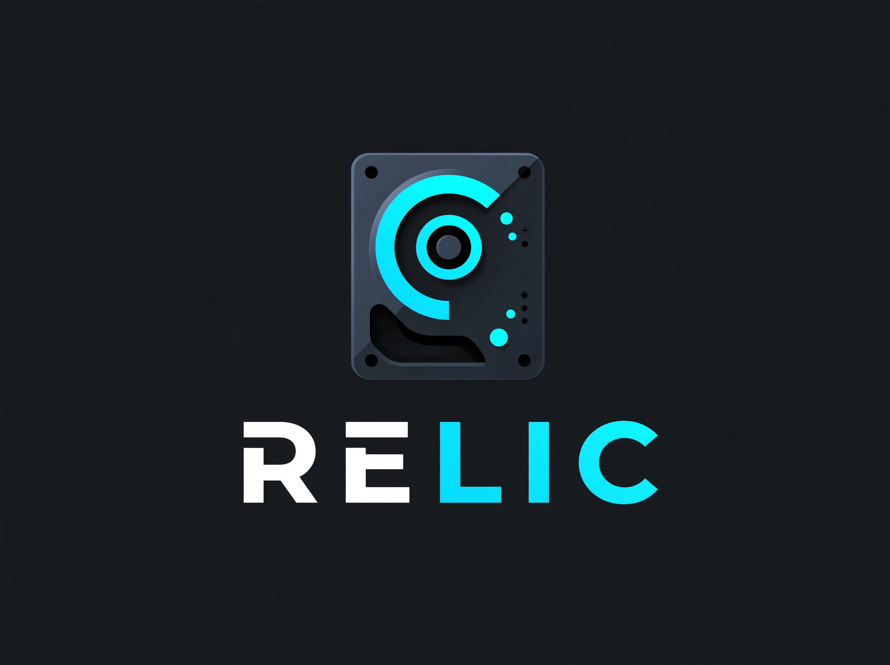

<p align="center">
  
</p>

# Nextron Relic

Relic is a cross-platform collector for forensic artifacts on Windows, Linux
and macOS, controlled by declarative YAML profiles. It is designed for
standalone use and for integration with the Nextron Management Center.

- **One static binary per OS and architecture.** No installation and no
  runtime dependencies.
- **Built-in artifact catalog and profiles:** `minimal`, `standard` (default)
  and `full`. Custom artifacts use the same YAML format.
- **Locked files on Windows.** Regular reads fall back to raw NTFS
  parsing; NTFS metadata files (`$MFT`, `$LogFile`, `$UsnJrnl:$J`) are read
  directly.
- **ZIP archive with full provenance.** The manifest records hashes,
  timestamps, access method and a status with reason for every matched
  file, including skipped and unreadable ones.
- **Stable interface for automation:** JSON result, status file, exit codes
  0–4, JSON Schema for the configuration.
- **Bounded resource use.** Limits for file size, total size, file count,
  run time, free disk space, memory and read rate; low CPU/I/O priority;
  clean cancellation.

## Quick start

```bash
# Default triage (standard profile) into the current directory
relic collect

# Smaller profile, archive into a directory, machine-readable result on stdout
relic collect --profile minimal --output /var/tmp/ --json

# See what would be collected without reading anything
relic collect --profile standard --dry-run

# Controlled by a configuration file
relic validate examples/management-center-windows-triage.yaml --os windows
relic collect -c examples/management-center-windows-triage.yaml --json --status-file status.json
```

Discover artifacts and profiles:

```bash
relic list profiles
relic list artifacts --os windows
relic show artifact windows.ntfs.usnjrnl     # YAML definition, usable as template
relic config show --profile minimal          # effective configuration with all defaults
relic config schema                          # JSON Schema of the configuration
```

Run as administrator / root to collect everything. Without privileges Relic
still runs and reports every unreadable file and directory. Windows raw NTFS
access requires administrative rights; LocalSystem is sufficient.

## Installation

Download the binary for your platform from the
[GitHub releases](https://github.com/Nextron-Labs/nextron-relic/releases)
and verify it with `SHA256SUMS`, or build it:

```bash
make            # ./relic for the host (requires Go 1.26+)
make dist       # dist/relic-<version>-<os>-<arch>[.exe] for all platforms + SHA256SUMS
make test       # unit and integration tests
```

## Platform support

| Platform | Built | Tested |
|---|---|---|
| macOS arm64 | yes | Unit and integration tests. Real collections as an unprivileged user (macOS 27, Apple Silicon). |
| macOS amd64 | yes | Not run. |
| Linux amd64 | yes | Real `standard` collection as root in Debian 13 (Docker, emulated amd64). |
| Linux arm64 | yes | Full test suite as root (Docker, Debian 13). |
| Linux 386 | yes | Not run. |
| Windows amd64 | yes | **Not run on Windows yet.** The Windows path logic and the raw NTFS pipeline are tested on macOS/Linux against an NTFS image. CI (`.github/workflows/ci.yml`) adds live tests on elevated Windows runners: `$MFT`, `$UsnJrnl:$J`, the locked SYSTEM hive, event logs. |
| Windows 386, arm64 | yes | Not run. |

Minimum versions follow the Go toolchain: Windows 10 / Server 2016, macOS 12,
Linux kernel 3.2.

## Documentation

- [Configuration](docs/configuration.md): format, selection, custom
  artifacts, path patterns and variables, access methods, limits.
- [Built-in artifacts](docs/artifacts.md): catalog and profile membership.
- [Output](docs/output.md): archive layout, file records, result JSON,
  status values and exit codes.
- [Management Center integration](docs/management-center-integration.md):
  playbook pattern and LocalSystem notes.
- [Design notes](docs/design.md): architecture, CyLR comparison, THOR
  reuse, licensing, assumptions, roadmap.
- [Releasing](docs/releasing.md): tag-triggered release workflow and assets.
- [Changelog](CHANGELOG.md)

## Exit codes

| Code | Status | Meaning |
|---|---|---|
| 0 | complete | All matching files collected. |
| 1 | partial | Usable archive, but something is missing (errors, limits); see `status_reason`. |
| 2 | failed | No usable archive. |
| 3 | canceled | Interrupted by a signal; the archive was finalized. |
| 4 | – | Invalid command line or configuration. |

## Known limitations

- **Windows has not been run on a real system yet** (see platform support).
  Raw NTFS access works only for NTFS volumes with a drive letter; ReFS,
  FAT, BitLocker-locked volumes and mount points without a letter fall back
  to OS reads only.
- **The NTFS metadata artifacts cover only `%SystemDrive%`.** `$MFT`, `$J`
  and `$LogFile` are not collected from other volumes yet.
- **No Volume Shadow Copy access.** Raw reads of files that are being
  written (registry hives, ESE databases) can be inconsistent; the record
  shows `method: ntfs_raw`. Use the transaction logs (`.LOG1/.LOG2`, ESE
  logs), which are collected along with them.
- **Access times.** Raw NTFS reads and Linux reads (`O_NOATIME`) do not
  change access times. Regular reads on Windows and macOS may update them,
  depending on system settings.
- **macOS:**
  - TCC-protected locations (Safari, TCC.db, KnowledgeC) need Full
    Disk Access for the process that starts Relic; without it they are
    reported as `operation not permitted`.
  - I/O priority is not lowered on macOS, only CPU priority.
  - Unified logs are collected as raw tracev3 files, not as a `.logarchive`.
- **No encryption and no upload.** Archives are unencrypted ZIP files and
  Relic has no upload function; transport is left to the Management Center
  or the operator.
- **Live sources.** Files that change while being read are recorded with
  `changed_during_read` (OS method). Growing files are read up to the current
  end or `max_file_size`.
- **Memory.** Memory use grows only with the number of matched paths: about
  16 bytes per path for de-duplication. File data is streamed through a
  fixed 1 MiB buffer.

## License

GPL-3.0, see [LICENSE](LICENSE). Third-party components and their licenses
are listed in [docs/design.md](docs/design.md#licensing).
