# Management Center integration

Relic is meant to become a native part of the Management Center: a component
called **Artefact Collection**. An analyst selects assets, chooses what to
collect in a dialogue, and reads the results in a section of their own. Nobody
edits a YAML file, uploads a playbook file or builds a playbook.

This guide describes how to design that component and how to connect it to
Relic.

> **Status: proposal.** Nothing here is implemented in the Management Center
> yet. The screenshots are mockups with sample data. Artefact names,
> categories, patterns and the counts derived from them come from Relic 0.3.0.
> The commands and JSON fields named here were run against that version on
> macOS. Windows-specific behavior (raw NTFS, LocalSystem, `$UsnJrnl:$J`) comes
> from the code and the existing documentation and was not run for this guide.
> Sources of the mockups: [`docs/mockups`](mockups/README.md).

*Spelling:* the UI and this guide write "artefact". Relic's interfaces write
`artifact` (`collect.artifacts`, `relic list artifacts`), and generated
configurations must use that spelling unchanged.

**Contents**

1. [Principles](#1-principles)
2. [Where it lives](#2-where-it-lives)
3. [The collection dialogue](#3-the-collection-dialogue)
4. [Connecting to Relic](#4-connecting-to-relic)
5. [The results section](#5-the-results-section)
6. [Permissions and evidence handling](#6-permissions-and-evidence-handling)
7. [What Relic should add](#7-what-relic-should-add)
8. [Open points for the Management Center](#8-open-points-for-the-management-center)
9. [Appendix: running Relic from a custom playbook](#appendix-running-relic-from-a-custom-playbook)

## 1. Principles

- **Decisions in the UI, files in the backend.** The analyst selects categories
  and artefacts. The server generates the configuration, picks the binary,
  runs it and collects the result.
- **The fast path takes two clicks.** Pick a template, click *Add Task*.
  Everything else is optional.
- **Show what will happen, and afterwards what is missing.** A collection is
  only useful if the analyst can tell what it does not contain.
- **Results are data, not a file.** Counters, categories, file lists, hashes
  and problems are stored and searchable. The ZIP archive is the evidence
  behind them.
- **Reuse what the Management Center already has:** *Add Task*, group tasks,
  labels, *Max. Runtime*, the template pattern of Scan Templates, roles and
  evidence storage.
- **One format.** A template is a Relic configuration. There is no second schema
  to keep in sync.

| | Custom playbook today | Artefact Collection |
|---|---|---|
| Choosing what to collect | Edit a YAML file offline, upload it to Playbook Files | Check categories and artefacts in the dialogue |
| Custom paths | Errors appear when the task has failed | Validated while typing, next to the field |
| Task ID, case, analyst | Fixed in the file or edited by hand | Filled in for every task |
| Mixed operating systems | One playbook per platform | One dialogue, one generated configuration per platform |
| Result | A row with a ZIP in Evidence Collection | Status, categories, files, hashes and problems in their own section |
| Integrity | Check by hand | Verified automatically after the upload |
| Reuse | Copy the playbook | Collection Templates |

The agent can use the same primitives as a playbook (download a file, run a
command, upload a file). That is an implementation detail. The user never sees a
playbook, and the component does not appear under Playbooks or Playbook Files.

## 2. Where it lives

The sidebar gets a new section **Artefact Collection** with three pages:
*Collections*, *Group Collections* and *Collection Templates*.

A collection can be started from these places. All of them open the same
dialogue:

| Entry point | Behavior |
|---|---|
| Assets, new icon in the *Actions* column | *Add Task* for this asset with the module preselected |
| Assets, several rows selected, *Add Task* | The module *Artefact Collection* appears next to *Run Playbook* and the others |
| Artefact Collection > Collections, *New Collection* | Same dialogue with an empty *Assets* field |
| Response Control > Group Tasks and scheduled group tasks | Task type *Artefact Collection*, see [Group tasks](#36-group-tasks) |
| Result of a collection, *Collect again* or *Collect these files* | Dialogue filled in from that collection |

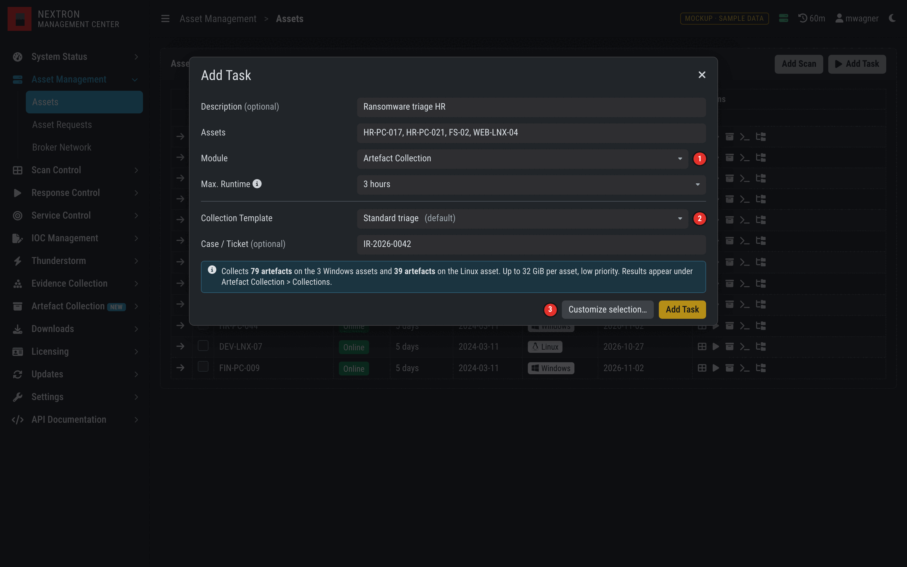

The first step is the existing *Add Task* dialogue:

1. **Module** gets the new value *Artefact Collection*.
2. **Collection Template** replaces the playbook selection. The default template
   is preselected, and the note below it states what will happen for the
   selected assets. Add a free-text **Case / Ticket** field here.
3. **Customize selection** widens the dialogue into the view below. *Add Task*
   starts the collection right away.

## 3. The collection dialogue

The dialogue has a fixed context strip (assets, template, description, case, max.
runtime), four tabs and a summary column. The tabs are not a wizard: every tab
can be reached at any time, and *Add Task* is enabled whenever the selection is
valid. Changing the template replaces the selection after a confirmation if the
analyst has made changes.

### 3.1 Artefacts

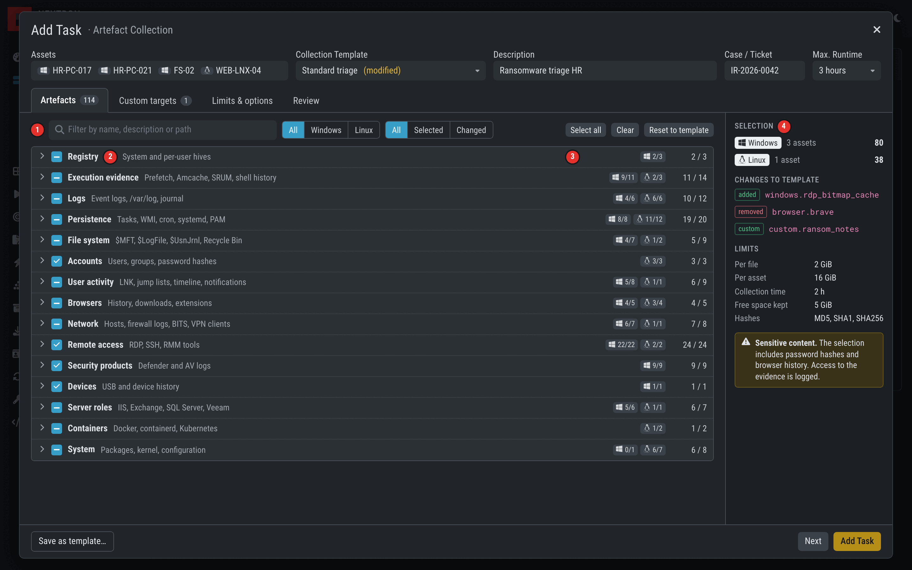

1. **Filter.** Searches name, category, description and path patterns, like
   `relic list artifacts --search`. Matching categories expand automatically.
   The switches narrow the view by operating system and to *Selected* or
   *Changed* entries.
2. **Category row with a tri-state checkbox.** Empty, partly selected, or
   fully selected. Clicking selects all entries of the category, clicking again
   clears them. Only entries that pass the current filter are affected.
3. **Counts per operating system.** Windows and Linux are counted separately,
   because the same selection means something different on each.
4. **Summary.** What each platform will get, what differs from the template, the
   effective limits, and warnings. It stays visible on the first three tabs.

The chevron expands a category without changing its selection.

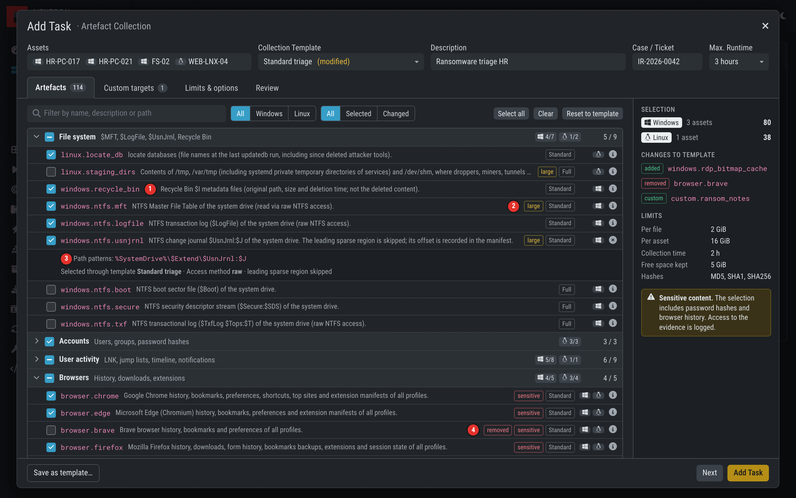

1. **Artefact row.** Checkbox, technical name, description. Show the name, so
   that UI, documentation and results use the same term.
2. **Hint tags.** `large` warns about size, `sensitive` about password hashes
   or personal data. The tag on the right is the smallest built-in profile
   containing the artefact. *Large* and *sensitive* are not in the catalog yet,
   see [section 7](#7-what-relic-should-add). Do not derive *large* from "only
   in `full`": that profile also holds the 8 KiB `$Boot` file.
3. **Details.** The info icon shows the path patterns and the access method from
   `relic show artifact <name> --json`.
4. **Difference to the template.** `added` and `removed` mark every change, and
   *Reset to template* undoes them.

Rules for the tree:

- Show only artefacts with a source for an operating system of the target
  assets (`os` field). Without assets, for example while editing a template,
  show all of them.
- Compute category state and counts over the visible platforms only.
- Keep two levels. Large categories such as *Remote access* (25 artefacts) are
  handled by the filter, not by a third level.
- Do not hard-code the catalog. It comes from the Relic version that will run,
  see [section 4.1](#41-catalog-and-defaults).

Relic provides the `category` key. The label, description and order are up to
the Management Center. Show unknown keys of newer Relic versions with a
capitalized fallback, so that a catalog update never hides artefacts.

| `category` | Label | Typical content |
|---|---|---|
| `registry` | Registry | System and per-user hives |
| `execution` | Execution evidence | Prefetch, Amcache, SRUM, shell history |
| `logs` | Logs | Event logs, `/var/log`, journal |
| `persistence` | Persistence | Tasks, WMI, cron, systemd, PAM |
| `file_system` | File system | `$MFT`, `$LogFile`, `$UsnJrnl`, Recycle Bin |
| `accounts` | Accounts | Users, groups, password hashes |
| `user_activity` | User activity | LNK, jump lists, timeline, notifications |
| `browser` | Browsers | History, downloads, extensions |
| `network` | Network | Hosts, firewall logs, BITS, VPN clients |
| `remote_access` | Remote access | RDP, SSH, RMM tools |
| `security` | Security products | Defender and AV logs |
| `devices` | Devices | USB and device history |
| `server` | Server roles | IIS, Exchange, SQL Server, Veeam |
| `containers` | Containers | Docker, containerd, Kubernetes |
| `system` | System | Packages, kernel, configuration |

### 3.2 Custom targets and excluded paths

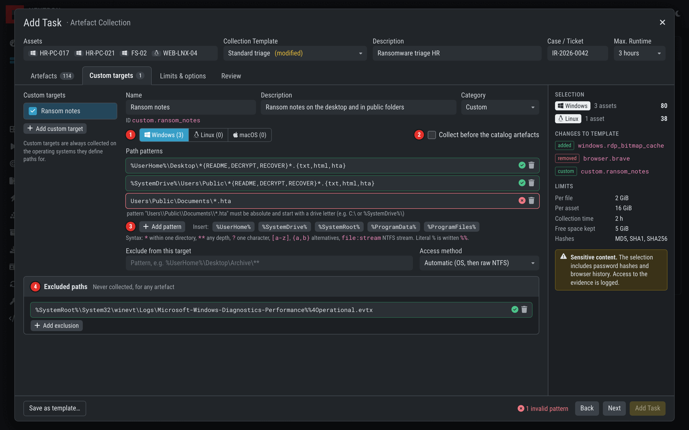

1. **Operating system tabs.** Each tab with at least one pattern becomes one
   source of the custom artefact. Windows and Unix patterns have different
   syntax, so never generate a source without `os`.
2. **Collect first.** Custom targets are collected after the catalog
   artefacts by default. This option moves them to the front, so that a time limit
   does not cut them off. See [section 4.2](#42-generating-the-configuration).
3. **Pattern helpers.** *Insert* offers the variables valid for the current tab,
   and a one-line syntax reminder stays visible. Full syntax:
   [path patterns](configuration.md#path-patterns).
4. **Excluded paths.** These apply to every artefact, built-in or custom.

| Field | Configuration | Rules |
|---|---|---|
| Name | `collect.custom_artifacts[].name` | Derive the ID, e.g. `custom.ransom_notes`. Must match `^[a-z0-9][a-z0-9_.-]*$`, be unique, and not clash with the catalog. |
| Description | `.description` | Free text, shown in the results. |
| Category | `.category` | Catalog categories plus *Custom*. Decides where results appear. |
| Path patterns | `.sources[].os`, `.sources[].paths` | Absolute, with wildcards and variables. Linux is case-sensitive, Windows and macOS are not. |
| Exclude from this target | `.sources[].exclude` | Patterns removed from this source. |
| Access method | `.sources[].method` | `auto`, `os`, or `raw`. Offer `raw` only on the Windows tab. |
| Excluded paths | `collect.exclude_paths` | A literal `%` is written `%%`, as in event log names. |

**Validation.** Send the generated configuration to `relic validate` on the
server after each edit, debounced. Each issue has a `path` such as
`collect.custom_artifacts[0].sources[0].paths[2]` and a `message`. Use the
`path` to place the `message` next to the field, and do not display the path
itself. *Add Task* stays disabled while an issue with severity `error` exists.

Warn, without blocking, about very wide patterns such as `C:\**`. A custom
target can read any file with LocalSystem rights, so adding one needs a separate
permission ([section 6](#6-permissions-and-evidence-handling)).

### 3.3 Limits and options

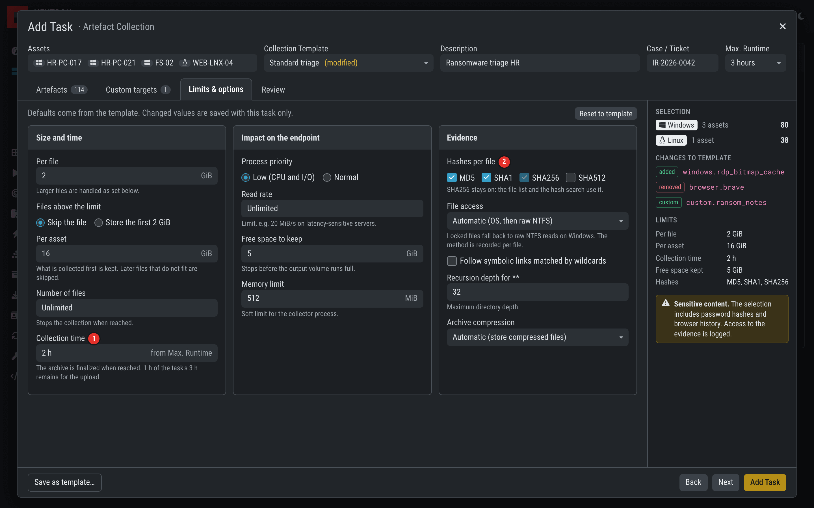

1. **Collection time** is derived from *Max. Runtime*, so that the analyst sees one
   timeout instead of two. It has to end well before the task does: Relic then
   finalizes a usable archive, and time remains for the upload. The mockup
   keeps one third of the runtime for the upload.
2. **SHA256 stays on**, because the file list and the hash search use it.

| Field | Configuration | Relic default |
|---|---|---|
| Per file | `limits.max_file_size` | 4 GiB |
| Files above the limit | `limits.oversize` | `skip` (or `truncate`) |
| Per asset | `limits.max_total_size` | 32 GiB |
| Number of files | `limits.max_files` | 0, unlimited |
| Collection time | `limits.max_duration` | 4 h |
| Process priority | `limits.priority` | `low` |
| Read rate | `limits.read_rate` | 0, unlimited |
| Free space to keep | `limits.min_free_space` | 1 GiB |
| Memory limit | `limits.max_memory` | 512 MiB |
| Hashes per file | `collect.hashes` | `sha256` |
| File access | `collect.method` | `auto` |
| Follow symbolic links | `collect.follow_symlinks` | `false` |
| Recursion depth | `collect.max_depth` | 32 |
| Archive compression | `output.compression`, `output.compression_level` | `auto`, 5 |

Read the defaults from `relic config show --json` instead of copying them. Send
sizes and durations as integers (bytes, seconds). Label sizes `GiB`: Relic
treats `GB` as powers of 1000.

Explain the consequence of a limit next to the field. Relic collects in a
defined order and keeps what came first: at `max_total_size` it skips files that
no longer fit, at `max_duration`, `max_files` and `min_free_space` it stops.

### 3.4 Review

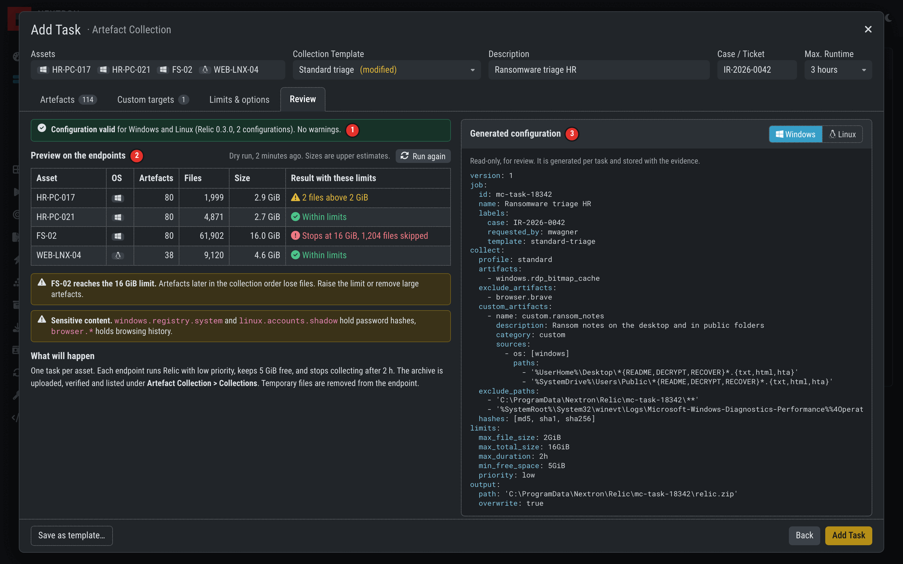

1. **Validation result** per operating system, from `relic validate`.
2. **Preview on the endpoints.** An optional dry run on the online assets. It
   reads no file content and writes no archive, and answers the question an
   analyst actually has: how much will this be, and will it fit?
3. **Generated configuration.** Read-only, per platform. It lets an expert check
   the result, and it is stored with the evidence. There is deliberately no way
   to edit it here. Changes are made in the tabs.

The preview is `relic collect --dry-run --json -q` with the generated
configuration. Use these fields:

| Column | Field |
|---|---|
| Artefacts | `summary.artifacts_selected` |
| Files | `summary.files_matched` |
| Size | `summary.bytes_collected` |
| Result with these limits | `limits[]`, `summary.files_skipped`, `status_reason` |

Present the numbers as estimates. Unreadable files only show up in the real run,
and raw `$UsnJrnl:$J` is counted with its logical size, capped by the per-file
limit, instead of the much smaller stored size. The result has counters per
artefact (`artifacts[]`) but no file list.

The review shows these warnings:

| Condition | Message |
|---|---|
| Preview hits a limit | Which asset, which limit, how many files |
| An artefact tagged `sensitive` is selected | What it contains, and that access to the evidence is logged |
| An asset is offline | The task starts when it connects |
| A platform gets no artefact | The selection is empty for those assets. Block them, or remove them from the task |
| No Relic build for an asset's OS and architecture | Remove the asset from the task |

### 3.5 Collection Templates

Collection Templates work like Scan Templates: *Add* and *Import* buttons, a
table with name, creator, comment, *Default* and *Is Restricted*, and export,
edit and delete actions.

- **Built-in templates** (*Minimal triage*, *Standard triage*, *Full collection*)
  map to Relic's profiles (`relic list profiles --json`) and are read-only.
- **A template is a Relic configuration** without `job` and `output`: profile,
  added and removed artefacts, custom targets, excluded paths, limits and hashes.
  Importing one is `relic validate`, so a configuration tested standalone can
  simply be imported. Expand wildcards into names on import.
- **A template keeps its baseline by reference.** When a Relic update adds an
  artefact to `standard`, *Standard triage* collects it. Saved changes are stored
  as added and removed names. Show a warning if an update removed one of them.
- *Save as template* in the dialogue stores the current state.

### 3.6 Group tasks

The *Add Group Task* form gets *Artefact Collection* as a task type, plus a
template selection, and *Customize* opens the same dialogue with all platforms
visible. There is no preview, because the targets are not known in advance.

Choose *Limit* and *Rate* with care: each asset uploads an archive of possibly
several gigabytes. Validate again at dispatch, because the Relic version may have
changed since a scheduled task was created.

## 4. Connecting to Relic

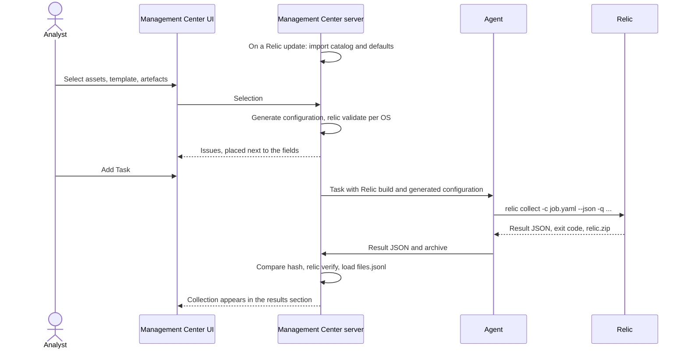

All interfaces are JSON and stable within a schema version: fields are only
added, so ignore unknown ones. `relic validate`, `list`, `show` and `verify` run
on any platform, so the server uses its own Linux build for them.

### 4.1 Catalog and defaults

Import these once per Relic version and keep them per version: results have to be
matched with the catalog of the version that produced them.

| Purpose | Command | Returns |
|---|---|---|
| Artefact list for the tree | `relic list artifacts --json` | `name`, `category`, `os`, `profiles`, `description` |
| Path patterns for the details | `relic show artifact <name> --json` | `sources[]` with `os`, `paths`, `exclude`, `method`, `trim_sparse` |
| Built-in templates | `relic list profiles --json` | `name`, `description`, `artifacts_per_os` |
| Profile content per platform, in collection order | `relic show profile <name> --json` | `resolved.windows[]`, `.linux[]`, `.darwin[]` |
| Default values | `relic config show --json` | Complete configuration |
| Configuration schema | `relic config schema` | JSON Schema (draft 2020-12) |

Platform keys are `windows`, `linux` and `darwin`. The UI says macOS.

### 4.2 Generating the configuration

Generate one configuration per task. Express the selection as a baseline with
differences:

```text
for each operating system among the target assets:
    base     = resolved[template.profile][os]      # relic show profile
    selected = checked artefacts that apply to os

    collect.profile           = template.profile
    collect.artifacts         = selected - base    # catalog order
    collect.exclude_artifacts = base - selected
    collect.custom_artifacts  = custom targets with a source for os
    collect.exclude_paths     = excluded paths + the task's work directory
```

[`examples/management-center-windows-triage.yaml`](../examples/management-center-windows-triage.yaml)
shows the result. The test suite validates it.

| UI | Configuration |
|---|---|
| Task ID | `job.id`, e.g. `mc-task-18342` |
| Description | `job.name` |
| Case / Ticket | `job.labels.case` |
| Logged-in user | `job.labels.requested_by` |
| Template | `job.labels.template` |

`job` is copied into the result and the manifest, which links the evidence to the
task. Rules for the generator:

1. **Generate per platform.** A name without a source for the platform is reported
   as `not_applicable` and causes a validation warning, so filter
   `collect.artifacts` and `custom_artifacts` by platform.
2. **Never generate wildcards.** The meaning of `browser.*` changes with the
   catalog. The analyst should get what the dialogue showed.
3. **Keep the collection order.** Relic processes the profile, then `artifacts`,
   then `custom_artifacts`. The profile order is deliberate, for example large
   logs come last. For *Collect first*, or a selection without a template, omit
   `profile` and list everything in `artifacts`: custom names are allowed there,
   and the list order is the collection order.
4. **Use a fixed output path per task,** with `overwrite: true`, for example
   `C:\ProgramData\Nextron\Relic\mc-task-18342\relic.zip`. The archive appears
   under this name only when it is complete. A killed run leaves only
   `relic.zip.partial`, so the upload fails visibly and no broken archive is
   transferred.
5. **Always exclude the work directory** in `collect.exclude_paths`. Relic does
   not exclude its own output yet. A custom target that covers the directory
   reads its own growing `.partial`. In a test this stored 4 GiB despite
   `max_total_size: 5MiB`, and the exclusion prevents it.
6. **Keep `limits.max_duration` below *Max. Runtime*** and keep `min_free_space`,
   so that a collection never fills the system drive.
7. **Validate on the server** before the task is created. Exit code 0 is valid
   (warnings allowed), 4 is invalid. The `artifacts[]` field of the validation
   result lists what will really be collected.

```bash
relic validate - --os windows --json < job.yaml
```

### 4.3 Running on the endpoint

The analyst sees none of these steps:

| Step | Action |
|---|---|
| 1 | The agent gets the Relic build for the asset's OS and architecture (Windows and Linux: amd64, 386, arm64; macOS: amd64, arm64). Verify its hash and cache it between tasks. |
| 2 | The agent gets the generated configuration, task-scoped and not through Playbook Files. |
| 3 | The agent runs `relic collect -c job.yaml --json -q --status-file status.json --log-file relic.jsonl` in the work directory. |
| 4 | The agent reports stdout (exactly one JSON object) and the exit code. |
| 5 | The agent uploads `relic.zip` and `status.json`, and `relic.jsonl` if there is no archive: it is the only log that survives such a run. |
| 6 | The agent removes the work directory, whatever the outcome. |

`relic collect -c -` also reads the configuration from stdin, in YAML or JSON, if
the agent can deliver it that way.

**Progress.** With `--log-file`, or `--log-format json` on stderr, Relic writes a
record at every `--progress-interval` (default 15 s):

```json
{"time":"...","level":"INFO","msg":"progress","artifact":"windows.eventlogs","step":"34/80","files":1204,"bytes":6549825126,"failed":0,"elapsed_seconds":1600}
```

If the agent can stream it, show `step` as a progress bar. Otherwise show the
state and the elapsed time. `step` counts artefacts, not bytes.

**Stop.** A stop button has the agent send SIGTERM or Ctrl+Break once. Relic
records the current file as `aborted`, finalizes the archive with what it has and
exits with code 3. That archive is usable and passes `relic verify`. A second
signal, or `TerminateProcess` on Windows, leaves only the `.partial`.

**Running as LocalSystem:**

- Relic enables `SeBackupPrivilege` and opens files with backup semantics, so ACLs
  do not block collection. Locked files fall back to raw NTFS reads.
- `%UserHome%` covers all user profiles via the registry ProfileList, not the
  environment of the SYSTEM account.
- The process runs with below-normal CPU and low I/O priority by default.
- Relic is a console program without UI. It handles Ctrl+C, Ctrl+Break and
  console close events by finalizing the archive.
- On macOS, root is not enough for TCC-protected locations: the agent needs Full
  Disk Access. Without it those files are reported as unreadable.

### 4.4 Processing the result

When the task ends, the server does the following, in this order:

1. **Store the result JSON** from stdout. It holds status, counters and the
   archive's size and hash. `manifest.json` in the archive has the same content
   but cannot contain the archive's own `output.size` and `output.sha256`.
2. **Set the status** according to the table below.
3. **Compare the received archive** with `output.size` and `output.sha256`.
4. **Run `relic verify`.** It checks the ZIP structure, the CRC of every entry,
   the manifest counters, the configuration hash and the size and hashes of every
   stored file, all without extracting. With `--result` it also proves the archive
   is the one the endpoint produced.

   ```bash
   relic verify relic.zip --result status.json --json
   ```

   Exit code 0 means verified, 2 means problems. Store `ok`, `files_verified`,
   `bytes_verified` and `problems[]`.
5. **Load `files.jsonl` into the database,** one row per record, for the file
   list and the hash search. Add the category through the artefact name.
6. **Keep the other archive members** (`relic.log`, `config.yaml`,
   `config.effective.yaml`) available on demand.

The category is not part of the result. Take it from the catalog of `tool.version`
for built-in artefacts (`artifacts[].custom` is unset), and from the stored
configuration for custom ones.

| Exit | `status` | UI status | Archive |
|---|---|---|---|
| 0 | `complete` | Complete | Usable. `not_found` artefacts are normal. |
| 1 | `partial` | Partial | Usable but incomplete. `status_reason` and `limits[]` explain. |
| 2 | `failed` | Failed | None. Show `status_reason`, `errors[]` and the log file. |
| 3 | `canceled` | Canceled | Usable, with what was collected until the stop. |
| 4 | `failed` | Failed | None. `issues[]` explains. This should not happen after validation, and suggests a version mismatch. |
| none | none | Failed | The process was killed or the agent lost contact, so there is no result. Tell this apart from a Relic failure. |

The UI adds the states *Queued*, *Running* and *Uploading* before these. Verification
is a separate state: *Pending*, *Verified* or *Mismatch*. A *Complete* collection
with a *Mismatch* must not look like a good one.

## 5. The results section

The existing Evidence Collection page lists files: path, size, host, type, hash.
That cannot answer the questions an analyst asks after a collection. Did it work?
What does it contain? What is missing? Can I trust it? The new section shows one
row per collection and lets the analyst drill down.

Archives stay in the existing evidence storage with its retention and download
handling. They can also appear in Evidence Collection with the type *Artefact
Collection*, linking to the detail view.

### 5.1 Collections

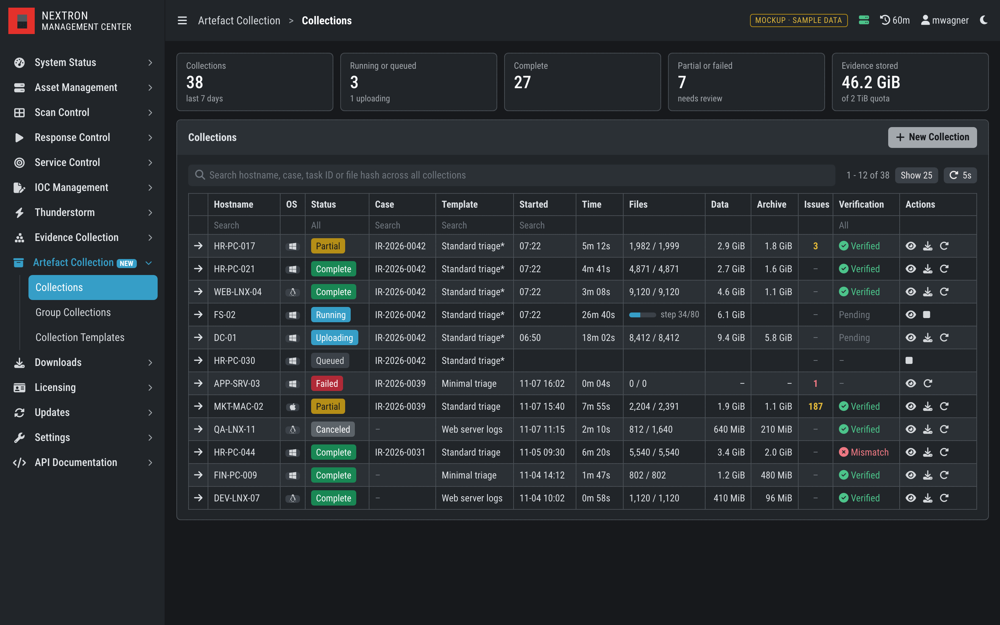

| Column | Source |
|---|---|
| Hostname, OS | The asset, then `host.hostname` and `host.os` |
| Status | See [section 4.4](#44-processing-the-result). While running, the progress bar replaces the file counts. |
| Case | `job.labels.case` |
| Template | `job.labels.template`. A `*` means it was modified for this task. |
| Started, Time | `started_at`, `duration_seconds` |
| Files | `summary.files_collected` + `files_truncated` / `summary.files_matched` |
| Data | `summary.bytes_collected` |
| Archive | `output.size` |
| Issues | `summary.files_failed` + `files_truncated` + `enumeration_errors` + files skipped by limits |
| Verification | Result of `relic verify` |

The search field works across all collections: hostname, case, task ID and file
hash. A hash search answers "where else did we see this file?", and returns the
matching files with a link to their collection. Refresh and filter the list as
other Management Center tables do.

### 5.2 Overview

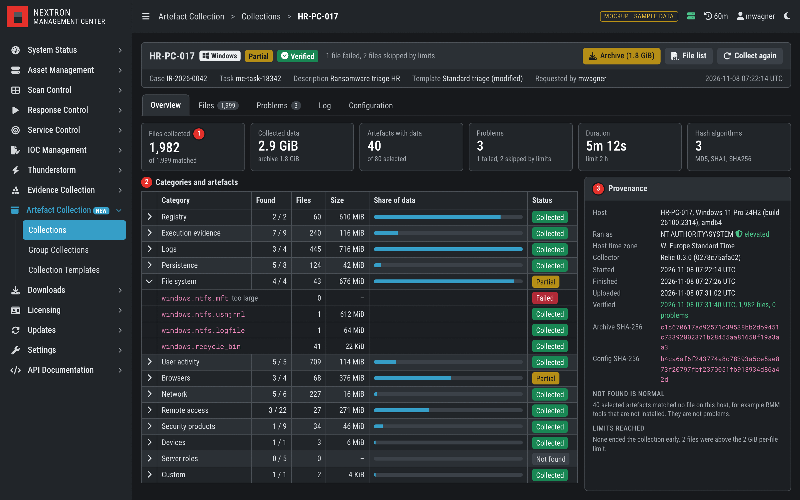

The header shows `status`, `status_reason` and the verification state, and offers
the archive, the file list as CSV, and *Collect again*.

1. **Counters** from `summary`. *Artefacts with data* counts `artifacts[]` entries
   with a status other than `not_found`.
2. **Categories and artefacts.** One row per category, expandable to `artifacts[]`.
   *Found* is artefacts with data out of those selected. Sum `files_collected` and
   `bytes_collected` per category. A category is *Not found* if no artefact has
   data, *Failed* if all artefacts with data are `failed`, *Partial* if any is
   `partial` or `failed`, and *Collected* otherwise.
3. **Provenance.** Everything needed to document where the evidence came from:

| Row | Source |
|---|---|
| Host | `host.hostname`, `host.os_version`, `host.arch` |
| Ran as | `host.user`, `host.elevated`. Warn if not elevated: protected files will be missing. |
| Host time zone | `host.time_zone` |
| Collector | `tool.version`, `tool.commit` |
| Started, Finished | `started_at`, `finished_at` |
| Uploaded, Verified | Management Center, `relic verify` |
| Archive SHA-256 | `output.sha256` |
| Config SHA-256 | `config.sha256` |

Treat `not_found` as neutral, never as an error. Most RMM and server artefacts
match nothing on a given host, and showing them as failures would bury the real
problems. Forty of the eighty artefacts in this sample are `not_found`.

### 5.3 Files

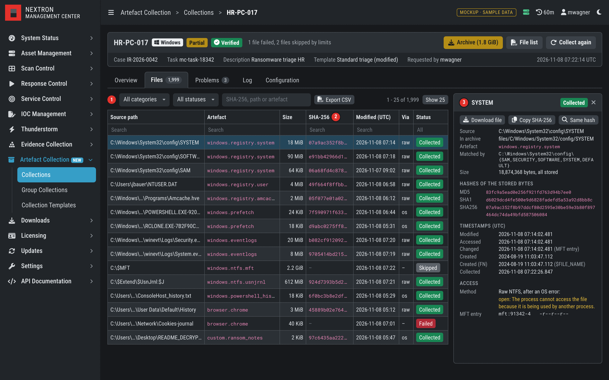

Everything in this tab comes from `files.jsonl`, with one record per matched file.
It can hold hundreds of thousands of rows, so page and filter on the server.

1. **Filters** for category, status and text, and a CSV export of the filtered
   list.
2. **Table.**

   | Column | Field |
   |---|---|
   | Source path | `source_path` |
   | Artefact | `artifact` |
   | Size | `bytes_stored`; `size` if nothing was stored |
   | SHA-256 | `hashes.sha256`, shortened, full value on hover and copy |
   | Modified | `times.modified` |
   | Via | `method`: `os`, or `ntfs_raw` shown as *raw* |
   | Status | `status` |

3. **Side pane** with the complete record:

   | Group | Fields |
   |---|---|
   | Location | `source_path`, `archive_path`, `artifact`, `pattern` |
   | Size | `size`, `bytes_stored`, `data_offset` |
   | Hashes | All entries of `hashes`. They cover exactly the stored bytes. |
   | Timestamps | `times.modified`, `accessed`, `changed`, `created`, `fn_created`, and `collected_at` |
   | Access | `method`, `fallback_reason`, `changed_during_read`, `reason` |
   | Metadata | `inode`, `mode`, `uid`, `gid`, `symlink_target` |

UI rules for this tab:

- **Truncate paths in the middle.** The file name is what the analyst is looking
  for, and an ellipsis at the end hides it.
- **Show UTC by default** and label it. `host.time_zone` can offer a conversion,
  but timestamps in the evidence stay UTC.
- **Mark what matters forensically:** `changed_during_read` (the hash matches the
  stored bytes, not necessarily the file as it is now), and `created` earlier than
  `fn_created` on raw NTFS records, a possible sign of timestomping.
- **Download a single file** by streaming the ZIP entry at `archive_path`, without
  unpacking the archive. Names are percent-encoded in the archive
  (`$UsnJrnl%3A$J`), so always use `archive_path` and never derive it.
- **Same hash** runs the hash search across all collections.

### 5.4 Problems

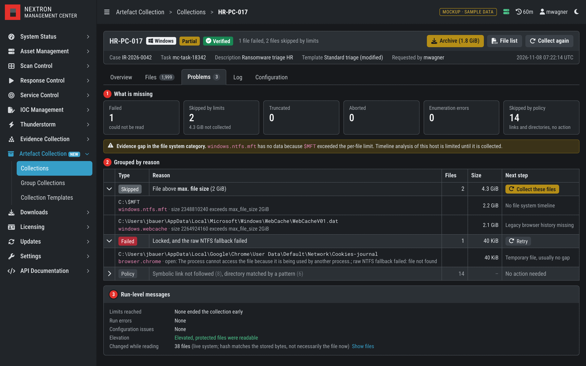

1. **What is missing.** One tile per kind of gap. Failed and aborted are separate
   here, although `summary.files_failed` counts both: count `aborted` records in
   `files.jsonl`.
2. **Grouped by reason,** with the affected files inside each group and a concrete
   next step. A note above the table names artefacts without any data, because an
   empty `windows.ntfs.mft` matters more than the file count suggests.
3. **Run-level messages:** `limits[]`, `errors[]`, `issues[]`, `host.elevated`, the
   number of `changed_during_read` records, and `artifacts[].errors` (up to 25 per
   artefact, the rest counted in `errors_dropped`).

Keep deliberate skips apart from real gaps. `summary.files_skipped` contains both
files skipped by a limit and symbolic links or directories skipped by policy, and
only the first are problems. `status_reason` contains the number of limit skips,
but until a machine-readable field exists ([section 7](#7-what-relic-should-add)),
classify the records by the text of `reason`:

| `status` | `reason` starts with | Kind | Next step |
|---|---|---|---|
| `skipped` | `size N exceeds max_file_size` | Limit | *Collect these files* with a higher limit |
| `skipped` | `would exceed max_total_size` | Limit | *Collect these files*, or raise the limit |
| `skipped` | `max_files limit reached` | Limit | Raise the limit |
| `skipped` | `min_free_space reached` | Limit | Free space on the endpoint, then collect again |
| `skipped` | `symbolic link not followed`, `broken symbolic link`, `is a directory`, `not a regular file` | Policy | None. Collapse this group. |
| `truncated` | `only the first` | Limit | *Collect these files* with a higher limit |
| `failed` | Any, for example `open:` or `read error after` | Read error | *Retry*. Check for encryption or the error text. |
| `aborted` | Any, for example `collection stopped after` | Stopped | *Collect these files* |

*Collect these files* opens the dialogue for the same asset with only the affected
artefacts selected, no profile, and the per-file limit raised above the largest
skipped file.

### 5.5 Log and Configuration

Two tabs without a screenshot:

- **Log** shows `relic.log` from the archive (JSON lines, UTC) as a table with
  filters for level and artefact.
- **Configuration** shows `config.yaml` (the generated input) and
  `config.effective.yaml` (with all defaults), read-only. *Save as template* reuses
  it. `relic verify` has already checked `config.yaml` against the hash in the
  manifest.

### 5.6 Group Collections

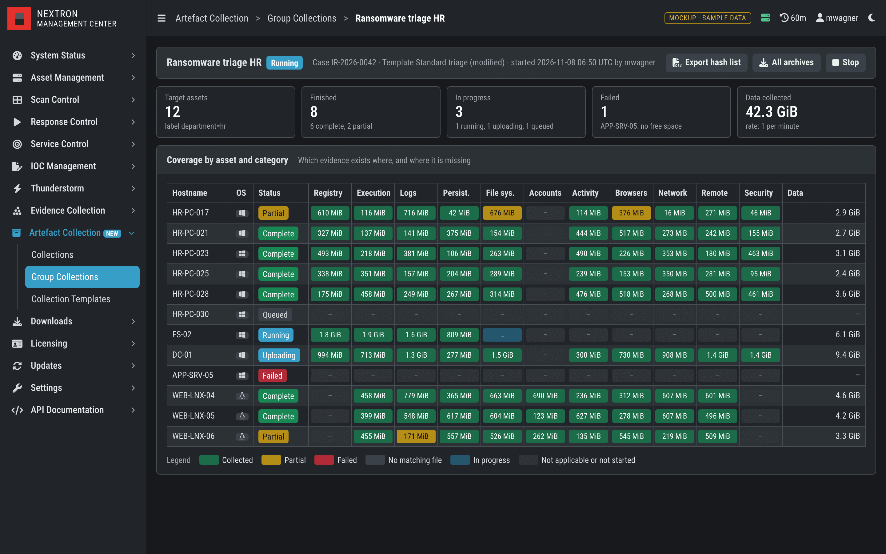

A group task gets one overview page. The matrix of assets and categories answers
the first question of an incident response at a glance: **which evidence exists
where, and where is it missing?** Cells use the category state from
[section 5.2](#52-overview) plus *not applicable*, and clicking a cell opens that
asset's collection, filtered to that category.

*Export hash list* writes one CSV with hostname, path and hash of all collected
files, for example for lookups or for comparing hosts. *All archives* downloads them
together.

## 6. Permissions and evidence handling

Follow the existing role model:

| Permission or restriction | Allows |
|---|---|
| Artefact Collection | Start collections from templates, view own results |
| Custom Collection Targets | Change the selection and add custom paths. A custom path can read any file with LocalSystem rights, including credentials. |
| Manage Collection Templates | Create, edit and delete templates, like *Manage Scan Templates* |
| View Collected Evidence | View and download results of other users. Keep this apart from starting a collection. |
| Force Collection Template (restriction) | Only unrestricted templates, no changes, like *Force Scan Template* |

*No Task Start* and *Readonly* apply unchanged. Log who started which collection
with which configuration, and every download of an archive or a single file.

**Treat all collected data as hostile input.** The endpoint may be compromised, so
file names, paths, log lines and even the result JSON are controlled by an attacker.

- Escape everything in the UI. A file name can contain HTML.
- Use the asset identity from the agent as the key, not `host.hostname`. Show a
  mismatch instead of trusting either.
- Never open or execute collected files on the server, and never write an archive
  member using a path from the archive.
- Set upper limits when parsing `files.jsonl` and `relic.log`.

**The archives hold sensitive data.** `standard` contains password hashes
(`linux.accounts.shadow`, `macos.accounts`, the SAM and SECURITY hives in
`windows.registry.system`), and browser and user activity categories hold personal
data. Relic writes an unencrypted ZIP. Offer retention and deletion per collection,
and provide a template without personal data for organizations that require it.

## 7. What Relic should add

The component can be built on Relic 0.3.0 as it is. These additions would remove the
workarounds described above. All of them are additive, so `schema_version` stays 1.

| Gap | Workaround today | Proposed addition |
|---|---|---|
| A custom target can collect Relic's own output | Generator adds the work directory to `exclude_paths` | Relic always excludes its output and temporary files |
| No category in results | Match `artifacts[].name` with the catalog per `tool.version` | `category` in `ArtifactResult` |
| `reason` is free text | Classify by text prefix | `reason_code` in `FileRecord` |
| Limit skips and policy skips share a counter | Count in `files.jsonl` | `files_skipped_limits` in `Summary` |
| Aborted files count as failed | Count in `files.jsonl` | `files_aborted` in `Summary` |
| No *large* and *sensitive* hints | Table kept in the Management Center | `tags` in the catalog and in `list artifacts --json` |
| Patterns need one call per artefact | Loop over `show artifact` during the import | `relic list artifacts --json --sources` |
| Dry run overstates `$UsnJrnl:$J` | Present sizes as estimates | Determine the stored size for sparse-trimmed streams |
| Progress only exists as a log record | Tail the log | A status file updated during the run |

The `opt_in` flag from the [roadmap](design.md#roadmap) would also let templates
offer risky artefacts (NTDS.dit, memory files) without selecting them through `full`.

## 8. Open points for the Management Center

- **Task-scoped files.** Can the agent fetch a generated configuration without Playbook
  Files, or take it on stdin?
- **Streaming.** Can the agent stream stderr or tail a file while a command runs? This
  decides whether a progress bar is possible.
- **Stop.** Can the agent signal a running process (SIGTERM, Ctrl+Break) instead of
  terminating it?
- **Large uploads.** How do multi-gigabyte uploads behave, and can they resume?
- **Encryption.** How is the encrypted evidence collection combined with Relic archives?
  See the roadmap in [`docs/design.md`](design.md#roadmap).
- **Storage.** Do the `files.jsonl` rows go into the existing database, and how are they
  sized and retained for hundreds of thousands of rows per collection?
- **Cases.** The mockups use a free-text case label. Is a real case object planned?
- **Distribution.** How do Relic builds reach the Management Center: bundled, or through
  the *Updates* section?

## Appendix: running Relic from a custom playbook

This is a stopgap until the component exists, not the target design. A custom playbook
has up to 16 sequential steps, and stdout and stderr of commands are reported back.

| Step | Type | Value (Windows example) |
|---|---|---|
| 1 | Download file | `relic.exe` → `C:\ProgramData\Nextron\Relic\relic.exe` |
| 2 | Download file | `job.yaml` → `C:\ProgramData\Nextron\Relic\job.yaml` |
| 3 | Run command | `C:\ProgramData\Nextron\Relic\relic.exe collect -c C:\ProgramData\Nextron\Relic\job.yaml --json -q --status-file C:\ProgramData\Nextron\Relic\out\status.json` |
| 4 | Upload file | `C:\ProgramData\Nextron\Relic\out\relic.zip` |
| 5 | Upload file (optional) | `C:\ProgramData\Nextron\Relic\out\status.json` |
| 6 | Run command (optional) | Cleanup of `C:\ProgramData\Nextron\Relic\out` |

The rules for the configuration are those of
[section 4.2](#42-generating-the-configuration). Adjust the paths of
[the example](../examples/management-center-windows-triage.yaml) to the directories above,
and treat exit codes 0 and 1 as success with a usable archive.
